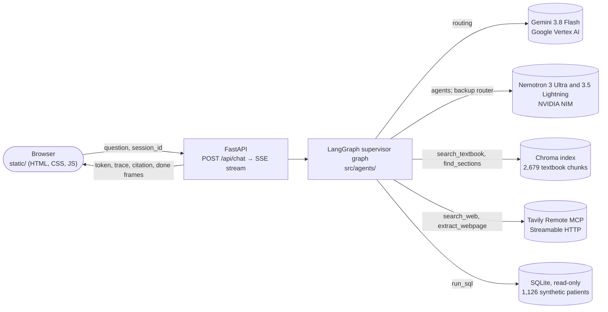
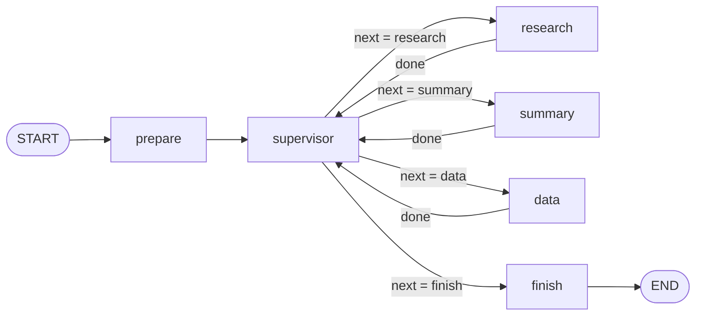

# Architecture

Health knowledge agents answers health questions from three kinds of evidence (an anatomy
textbook, the live web, and a synthetic patient database) with a LangGraph supervisor and three
specialist agents, routed across two LLM providers. This document covers the orchestration
graph and its state, each agent's tools and model, the routing rationale, the RAG pipeline, MCP
tool sharing, failure handling, and what conversation state the deployment does and does not
keep. Measurements are in [evaluation.md](evaluation.md).

## System



The browser posts a question with a session ID; the API runs one graph turn and streams it back
as Server-Sent Events: answer tokens as they are generated, a trace event for every routing
decision, model call, and tool call, the cited sources, and timings. The UI draws the trace as
a route panel (which agent ran on which provider, and why) and a latency timeline.

## Orchestration graph

The supervisor pattern: a central supervisor node routes to worker agents, and every worker
returns to the supervisor.



- **prepare** resets the per-turn fields and records the user's message.
- **supervisor**, on its first visit in a turn, makes one routing call that returns a
  `RoutePlan` (below) and stores it in `plan`. On every visit it sets `next` to the next agent in
  `plan` not yet in `completed`, or to `finish`. Every transition is therefore read from state
  fields (`plan`, `completed`, `next`), and the conditional edge maps `next` to a node.
- **research, summary, data** each run one agent (below) and append a record to `completed`.
  A worker that fails on both providers appends a record with its error, and the plan continues.
- **finish** picks the final answer (the last agent's, or the supervisor's direct reply for a
  greeting), keeps only the sources the answer cites, and adds the answer to the conversation.

### State schema

`AgentState` (`src/agents/graph.py`):

| Field | Type | Meaning |
|---|---|---|
| `messages` | list of messages, appended with `add_messages` | Conversation memory for the session (the checkpointer keys it by `session_id`) |
| `question` | str | The user's latest message, as typed |
| `standalone` | str | The same question rewritten to stand alone ("which one?" → "which heart chamber?"), used for retrieval |
| `plan` | list of agent names, or None | Agents to run this turn, in order; None until the supervisor plans |
| `route_reason` | str | The supervisor's one-sentence rationale, shown in the UI |
| `reply` | str or None | The supervisor's direct reply when `plan` is empty (greetings, off-topic) |
| `next` | str | The node the supervisor routes to next |
| `completed` | list of dicts | One record per agent run: agent, provider, model, answer, tools used, timings, error |
| `sources` | list of dicts | Numbered evidence gathered this turn by all agents (kind, key, title, URL, text) |
| `answer` | str | The final answer |
| `citations` | list of dicts | The sources the final answer cites, with a snippet each |

`RoutePlan` (`src/agents/plan.py`), the supervisor's structured output: `agents` (0 to 3 of
`research`, `summary`, `data`, in order; the last one writes the final answer), `reason`,
`standalone`, and `reply`.

The router sees the conversation as one labeled message: the last three exchanges, each
clipped to 300 characters, marked as already answered, then "Latest message, the only one to
route". Raw chat turns had let the small backup router plan for an earlier question as part of
a new one.

## Agents

Each agent has its own tools and its own prompts, and runs in two phases:

1. **Tool loop.** The agent's model decides which of its tools to call, for up to 4 rounds and
   4 tool calls; calls requested in the same round run concurrently. Every result is numbered
   into the turn's source registry. The agent replies `DONE` when it has enough evidence.
2. **Answer.** A separate call with no tools writes the answer from the numbered sources,
   citing them as `[n]`. Only this call's tokens are streamed to the user, so tool-call
   arguments and `DONE` never appear in the answer.

| Agent | Responsibility | Tools | Prompts (`src/agents/prompts.py`) |
|---|---|---|---|
| Supervisor | Plans each turn: which agents, in what order, why; rewrites follow-ups; answers greetings directly | none | `SUPERVISOR`, `PLAN_AS_JSON` |
| Research | Answers anatomy and physiology questions from the textbook, and current questions from the web | `search_textbook`, `search_web` | `RESEARCH_TOOLS`, `RESEARCH_ANSWER` |
| Summary | Summarizes a textbook section, a whole chapter, or a web article | `find_sections`, `read_section`, `summarize_chapter`, `search_web`, `extract_webpage` | `SUMMARY_TOOLS`, `SECTION_DIGEST`, `SUMMARY_ANSWER` |
| Data | Answers questions about the synthetic patient population with real SQL | `run_sql` | `DATA_TOOLS` (includes the schema), `DATA_ANSWER` |

| Tool | What it does | Limits |
|---|---|---|
| `search_textbook` | Top-5 chunk search over the Chroma index. Research also runs it automatically before its first round, with the standalone question | One search beyond that prefetch per turn |
| `find_sections` | Searches 10 chunks and returns the distinct sections they come from (IDs and titles) | |
| `read_section` | Returns a whole textbook section by ID | 30,000 characters; each section once per turn |
| `summarize_chapter` | Reads every section of a chapter in full and condenses each in parallel (map), for the answer call to combine (reduce) | 6 sections at a time, 45 s per section; a failed section is reported, not fatal |
| `search_web` | Tavily search through the Remote MCP server | 2 per agent per turn, 3 results each, 1,500 characters per result |
| `extract_webpage` | Tavily page extraction through the Remote MCP server | |
| `run_sql` | One `SELECT` (or `WITH … SELECT`) on a read-only SQLite connection (`mode=ro`) | Single statement, 5 s timeout, 50 rows |

The patient database comes from Synthea (seed 599, 1,126 fictional patients in Los Angeles,
10 years of history), reduced to seven tables: patients, conditions, medications, encounters,
immunizations, allergies, and the latest lab and vital-sign values per patient. It holds no
names, addresses, or ID numbers.

## LLM routing

Each agent has a fixed primary provider chosen for its job, and a backup on the other provider.
Every turn calls both providers: Gemini is asked for the plan, and Nemotron runs the agents. How
often Gemini's plan is the one used depends on Vertex AI's latency that day: 73% of local test
turns, and 5 of 18 deployed requests on the night measured
([evaluation.md](evaluation.md#34-routing)). The trace records,
for every model call, the agent, provider, exact model, routing dimension, and reason, and the
UI shows them per turn.

| Agent | Primary | Dimension | Why | Backup |
|---|---|---|---|---|
| Supervisor | Gemini 3.8 Flash (Google, Vertex AI) | Cost | Routing is one short structured-output call per turn: a low-cost model is enough, and spending it on Gemini keeps NVIDIA's free-tier request budget (about 40 requests a minute) for the agents' heavier generation | Nemotron 3.5 Lightning (NVIDIA) |
| Research | Nemotron 3 Ultra (NVIDIA) | Capability | Multi-source synthesis (textbook and web) with citations needs the most capable model, and Nemotron Ultra was also faster per call (0.7–1.0 s warm against 2–4 s for Gemini) | Gemini 3.8 Flash |
| Summary | Nemotron 3 Ultra (NVIDIA) | Capability | Summaries read whole sections, and chapter summaries condense every section of a chapter (up to ~16k tokens each); Nemotron handled long inputs reliably, while Gemini on Vertex AI hit a 504 deadline on a long summary | Gemini 3.8 Flash |
| Data | Nemotron 3 Ultra (NVIDIA) | Capability | Writing correct SQL over an unfamiliar schema and recovering from query errors rewards the stronger tool-calling model | Gemini 3.8 Flash |

**When the backup runs.**
- **Router:** if Gemini errors (for example a 429 from Vertex AI's shared pay-as-you-go
  capacity), the Lightning router plans immediately. If Gemini is merely slow, Lightning starts
  after 4 s and runs alongside it (a hedged request); the first plan back wins and the other
  call is cancelled. Hard limits are 12 s for Gemini and 10 s for Lightning; if both fail, the
  plan defaults to Research.
- **Agents:** an agent whose provider errors, or takes over 90 s, reruns on the other provider.
  The client is told to discard any partially streamed answer.

The trace marks each fallback, the reason it started, and any cancelled call.

## RAG pipeline

| Stage | Implementation |
|---|---|
| Corpus | OpenStax *Anatomy & Physiology 2e* (CC BY-NC-SA 4.0), extracted from the book's CNXML source by `scripts/extract_openstax.py`: 28 chapters, 197 sections, ~415k words, with headings kept as markdown |
| Chunking | Heading-aware recursive split (`src/rag/chunking.py`): separators try subsection headings first, then paragraphs, lines, sentence ends, and words; 1,500 characters with 200 overlap. Each chunk is prefixed with its breadcrumb (chapter > section > subsections), so a chunk that never names its topic still matches queries about it. 2,679 chunks, median ~1,160 characters, with stable IDs like `ap2e-19.3#4` |
| Embeddings | `BAAI/bge-small-en-v1.5` (384 dimensions), run locally as ONNX through fastembed; the BGE query instruction is added to queries only |
| Store | Chroma, persistent, cosine distance (HNSW). A manifest records the embedding model, and retrieval refuses an index built with a different one. The index is built inside the Docker image and is read-only at run time |
| Retrieval | k = 5 chunks, for the standalone question. `find_sections` searches 10 chunks to pick sections; `read_section` and `summarize_chapter` read whole sections |
| Augmentation | Retrieved text is numbered into the turn's source registry and placed in the answer call (template below) |
| Generation | The agent's answer call, which must cite every factual claim as `[n]` |
| Citations | `finish` keeps only the sources the answer cites. Each citation event carries the chunk ID, URL, or SQL query; the UI numbers them 1, 2, 3 in order of first use and links each `[n]` to its source card |

**Augmentation prompt template** (the Research answer call):

```text
[system]  You are the Research agent of a health-knowledge assistant. Write the answer to the
          user's question from the textbook and web sources below.
          Rules for your answer:
          - Use only the numbered sources provided. Cite each factual claim with its number in
            square brackets, like [2], or [1][3] for several.
          - If the sources do not answer part of the question, say so plainly in one sentence
            instead of guessing. Refer to sources only through citations: do not list, number,
            or comment on sources you did not use.
          - Lead with the direct answer, then supporting detail. Keep it to about 150-250 words
            unless the user asks for more detail. Use at most one small table, and only to
            compare items.
          - Write for a general audience; do not address clinicians or give treatment instructions.
          - This is educational information, not medical advice. If the user asks for personal
            medical advice, give general information and suggest they talk to a clinician.
[history] the last three exchanges of the conversation
[user]    Question: {question}
          (In context: {standalone question}, when the question was a follow-up)

          Sources:
          [1] OpenStax A&P 2e §19.1 Heart Anatomy
          The Cardiovascular System: The Heart > Heart Anatomy > Chambers and Circulation through the Heart

          {chunk text}

          [2] ...
```

The Summary and Data answer calls use the same structure with their own instructions. For a
chapter summary, each source is a section's digest, and the source card still shows the real
section text.

A retrieval check over 50 of the book's own critical-thinking questions (`scripts/check_retrieval.py`)
found the question's source section in the top 5 for 88% (top 1: 58%, MRR 0.708), against 76%
for a BM25 keyword baseline. Several "misses" retrieved the answer from a different section
than the question's label, so these are lower bounds.

## MCP tool sharing

One MCP server, Tavily's Remote MCP, is shared by two agents. The client (`src/agents/web.py`)
connects over Streamable HTTP with the API key as a query parameter on the endpoint URL, discovers
the server's tools with `tools/list` at startup, and calls them with `tools/call`.

- **Research** calls `tavily_search` (as `search_web`) to ground answers in current sources:
  guidelines, drug approvals, statistics, news.
- **Summary** calls the same `tavily_search` to find an article to condense, and
  `tavily_extract` (as `extract_webpage`) to read it.

Sharing one server rather than giving each agent its own search integration keeps one
connection, one API key, one set of result limits, and one failure path, and each call is
traced with the agent that made it, so the same tool used in two contexts is visible per turn.

If the server is unreachable, the web tools are omitted from the agents' toolsets and the agents
answer from the textbook; the client retries the connection at most once a minute. Error
messages are passed through a redaction step before they reach the trace or a model, and HTTP
client logging is kept at WARNING, because the endpoint URL contains the key.

## Failure handling

| Failure | Handling |
|---|---|
| Router provider errors or is slow | Immediate failover, or a hedged request after 4 s, to the other provider's router; Research if both fail |
| Agent provider errors or exceeds 90 s | The agent reruns on the other provider; partially streamed text is discarded |
| Agent fails on both providers | Recorded in `completed` with its error; the plan continues; the turn ends with the best answer available |
| Tool error (SQL error, MCP error, unknown tool) | Returned to the agent as a tool message, so it can correct the call or continue without it |
| Tool budget reached | Further calls are answered "budget used up"; the agent answers with what it has |
| MCP server unavailable | Web tools are absent; retried at most once a minute |
| Unexpected exception in a turn | The stream sends an error frame and a done frame, so the client never hangs |

Graph-level tests (`tests/test_agents.py`) cover each row with scripted models.

## Conversation memory and deployment

Conversation memory is a LangGraph `InMemorySaver` checkpointer keyed by the browser's
`session_id`. It lives in the memory of the running Cloud Run instance and is **not durable**:
it is lost when the service scales to zero after a period without traffic, or when the instance
is replaced. The service runs at most one instance, so every request in a session reaches the
instance that holds its history. The application does not claim memory beyond that, so it uses
no external store.

The Chroma index is a separate concern: it is built into the container image at build time and
only read at run time.

Deployment (`scripts/deploy.sh`, `scripts/deploy.ps1`, `Dockerfile`):
- **Build:** Cloud Build builds the image, including the index, from a fresh clone.
- **Service:** Cloud Run, public, 2 GiB, 1 vCPU with startup boost, concurrency 10, 300 s
  request timeout, 0 to 1 instances.
- **Credentials:** the NVIDIA and Tavily keys are in Secret Manager, readable only by the
  service's own service account, which also holds the Vertex AI User role, so Gemini needs no
  API key.
- **Startup:** the instance connects to Tavily and makes one small call per model client before
  serving, so the first question isn't slowed by connection setup.
